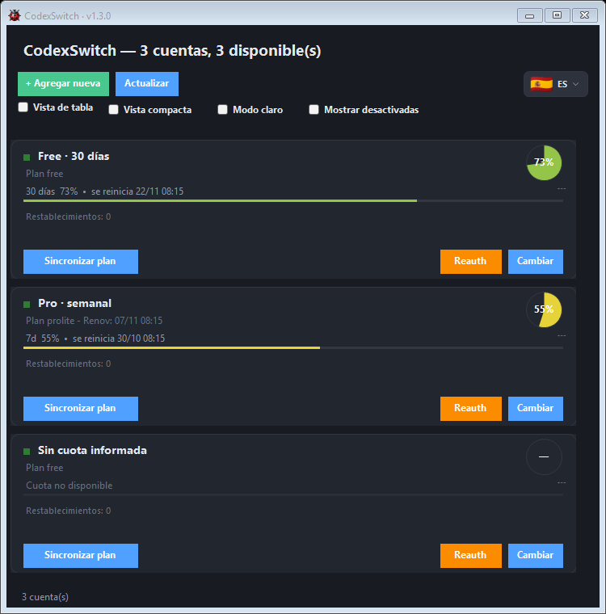
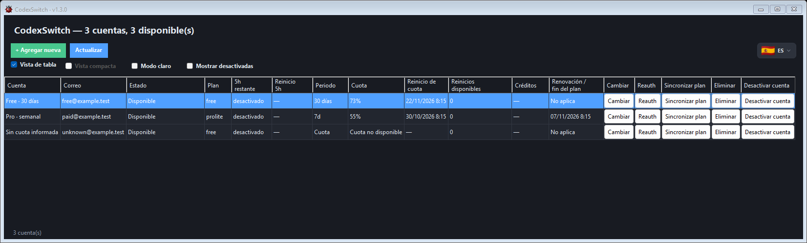
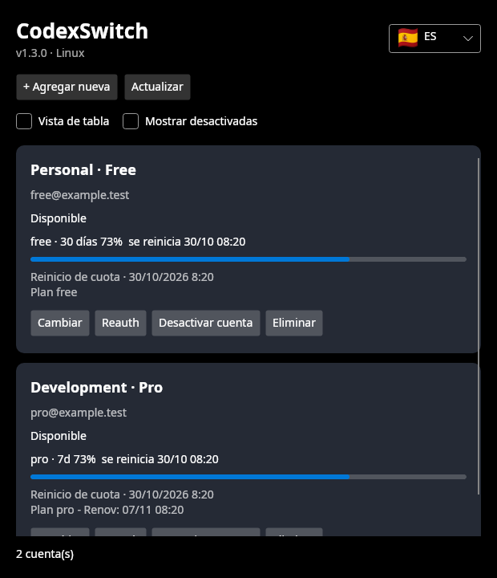

# CodexSwitch

CodexSwitch reúne tus cuentas de Codex en una ventana para consultar sus cuotas y elegir la cuenta que vas a utilizar. Puedes comparar cuentas en una tabla o verlas como tarjetas, y ocultar temporalmente las que no necesitas sin borrar sus credenciales.

- **Ventana adaptada a cada vista:** Tabla se abre con más ancho y Tarjetas recupera su tamaño; ambas conservan su posición.
- **Cuotas claras:** límites de 5 horas, semanales o de 30 días cuando el servicio los proporciona, con el porcentaje disponible y su reinicio.
- **Plan separado del uso:** diferencia entre renovación del plan y reinicio de cuota, sin inventar fechas ni porcentajes ausentes.
- **Siete idiomas:** EN, ES, CA, FR, DE, IT y PT con cambio inmediato.
- **Windows y Linux:** instalador y edición portable para cada plataforma.

*Windows 1.3.0, tarjetas con datos sintéticos de prueba.*

*Windows 1.3.0, tabla con ajuste automático de ventana.*

*Linux 1.3.0, interfaz real renderizada durante la prueba en Ubuntu 24.04/X11 con datos sintéticos.*

Las capturas de 1.3.0 siguen representando la interfaz de 1.3.1; esta versión corrige únicamente el proceso de compilación y empaquetado.

## Versión actual: 1.3.1 · 23 de octubre de 2026

| Plataforma | Instalador | Portable |
| --- | --- | --- |
| Windows x64 | [Descargar EXE](https://github.com/CCRelease/Weylan/raw/refs/heads/main/CoolCode/Release/CodexSwitch/versions/1.3.1/CodexSwitch-1.3.1-win-x64-setup.exe) | [Descargar ZIP](https://github.com/CCRelease/Weylan/raw/refs/heads/main/CoolCode/Release/CodexSwitch/versions/1.3.1/CodexSwitch-1.3.1-win-x64-portable.zip) |
| Ubuntu 24.04 x64 | [Descargar DEB](https://github.com/CCRelease/Weylan/raw/refs/heads/main/CoolCode/Release/CodexSwitch/versions/1.3.1/CodexSwitch-1.3.1-linux-x64.deb) | [Descargar TAR.GZ](https://github.com/CCRelease/Weylan/raw/refs/heads/main/CoolCode/Release/CodexSwitch/versions/1.3.1/CodexSwitch-1.3.1-linux-x64-portable.tar.gz) |

Windows requiere Windows 10 1809 o posterior. Linux se ha validado en Ubuntu 24.04 x64 con X11; Wayland y otras distribuciones no se han certificado. Los paquetes incluyen .NET.

En Windows ejecuta el instalador; crea por defecto accesos en Escritorio e Inicio. En Linux abre el DEB con el gestor de paquetes o ejecuta `sudo apt install ./CodexSwitch-1.3.1-linux-x64.deb`; crea accesos de menú y escritorio con su icono.

Para usar la edición portable, extrae todos los archivos y ejecuta `CodexSwitch.exe` o `codexswitch/CodexSwitch.Linux`. Extraer no registra una instalación; las instrucciones explican cómo crear un acceso con icono.

Añade las cuentas mediante el inicio de sesión de Codex. Windows puede integrar Codex Desktop y ofrece bandeja y sincronización manual del plan mediante WebView2. Linux gestiona Codex CLI y requiere `codex` en PATH: cierra las sesiones abiertas antes de cambiar y abre una nueva después. Linux no incorpora esas funciones de escritorio específicas de Windows. La información de cuotas y renovación depende del servicio.

Para desinstalar Windows, cierra desde la bandeja y usa Aplicaciones instaladas. En Linux cierra la ventana y ejecuta `sudo apt remove coolcode-codexswitch`. Ambos instaladores retiran sus accesos; los datos personales se conservan. La edición portable se retira cerrándola y eliminando su carpeta y el acceso que hayas creado.

Verifica los hashes y la firma CMS antes de instalar. Los ejecutables Windows y el instalador tienen firma Authenticode de un certificado privado CoolCode. [Instrucciones y verificación de firmas](versions/1.3.1/INSTALL.md) · [Hashes](versions/1.3.1/SHA256SUMS.txt) · [Versión vigente en JSON](latest.json).

## Historial

- [1.3.1](versions/1.3.1/INSTALL.md): compilación y publicación desde bin/Release de cada proyecto; firma y empaquetado vinculados a esas salidas.

- [1.3.0](versions/1.3.0/INSTALL.md): ventana adaptada a tarjetas/tabla; primera edición Linux; incorpora las mejoras de cuotas, renovación y cuentas desactivables realizadas desde la publicación anterior.
- [1.2.0](versions/1.2.0/INSTALL.md): primera publicación en Weylan, con gestión de cuentas, indicadores, vista compacta y siete idiomas.
