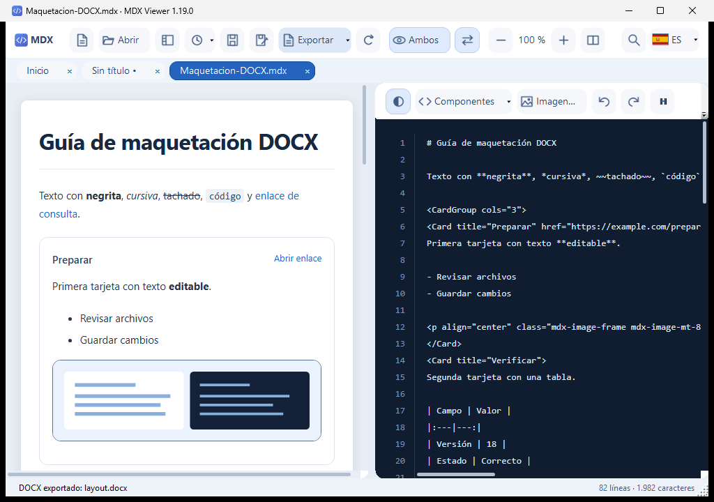
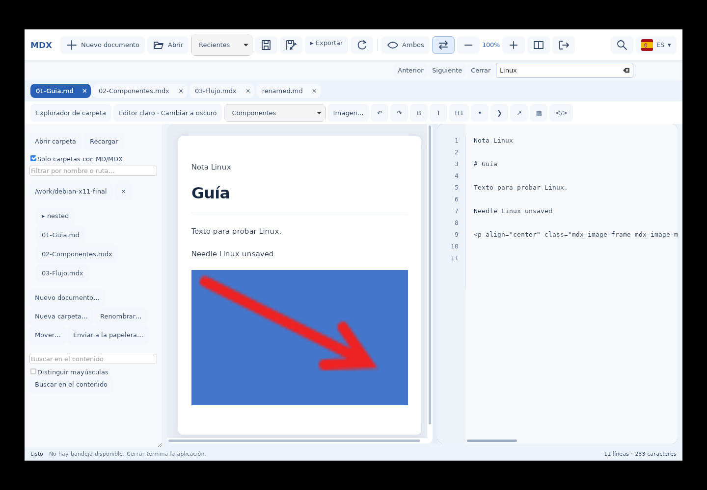

# MDX Viewer

MDX Viewer permite leer y editar documentos Markdown y MDX en una misma ventana. Está pensado para preparar documentación, revisar el resultado mientras escribes y compartirlo como HTML, ZIP, PDF o DOCX editable.

- **Vista previa y código juntos:** compara el documento con su contenido editable y ajusta el espacio de cada panel.
- **Varios documentos en pestañas:** cambia de archivo sin perder las ediciones pendientes.
- **Documentación con formato:** visualiza tablas, bloques de código, avisos, secciones desplegables y diagramas Mermaid compatibles.
- **Herramientas de trabajo:** busca texto, guarda los cambios, busca en varias carpetas, recorta y anota imágenes, exporta a HTML, ZIP, PDF o DOCX y cambia el idioma de la interfaz.

*Captura real de Windows 1.19.0 con la guía de maquetación DOCX y el editor.*

*Captura real de Linux 1.3.0 con documentos de prueba: vista previa a la izquierda y código a la derecha.*

## Versiones y descargas

Versiones actuales: **Windows 1.19.0** — 4 de noviembre de 2026 · **Linux 1.3.0** — 4 de noviembre de 2026. Paquetes autónomos con .NET 10 incluido.

| Plataforma | Instalador | Portable |
| --- | --- | --- |
| Windows 10/11 x64 · 1.19.0 | [Descargar EXE](https://github.com/CCRelease/Weylan/raw/refs/heads/main/CoolCode/Release/MDXViewer/versions/1.19.0/MDXViewer-1.19.0-win-x64-setup.exe) | [Descargar ZIP](https://github.com/CCRelease/Weylan/raw/refs/heads/main/CoolCode/Release/MDXViewer/versions/1.19.0/MDXViewer-1.19.0-win-x64-portable.zip) |
| Debian 12 / Ubuntu 24.04 x64 · 1.3.0 | [Descargar DEB](https://github.com/CCRelease/Weylan/raw/refs/heads/main/CoolCode/Release/MDXViewer/versions/1.3.0/coolcode-mdxviewer-linux_1.3.0_amd64.deb) | [Descargar TAR.GZ](https://github.com/CCRelease/Weylan/raw/refs/heads/main/CoolCode/Release/MDXViewer/versions/1.3.0/mdxviewer-linux-1.3.0-linux-x64.tar.gz) |

## Instalar y utilizar

Windows: ejecuta el instalador después de comprobar su hash. Crea los accesos del escritorio y de Inicio. Requiere Microsoft Edge WebView2 Runtime; no requiere instalar .NET. Para desinstalar, elige Salir en la bandeja y usa Aplicaciones instaladas.

Linux: ejecuta sudo apt install ./coolcode-mdxviewer-linux_1.3.0_amd64.deb desde la carpeta descargada. Instala las dependencias GTK/WebKitGTK y los accesos de menú y escritorio. Para desinstalar, elige Salir y ejecuta sudo apt remove coolcode-mdxviewer-linux. Verificado en Ubuntu 24.04 con X11 y Debian 12 con X11 y Wayland (Weston anidado). Otros escritorios pueden utilizar AppIndicator; GNOME puede necesitar su extensión.

Portable: extrae todo en una carpeta nueva y ejecuta MDXViewer.exe en Windows o MDXViewer.Linux en Linux. Necesita WebView2 o GTK/WebKitGTK respectivamente. Extraer el archivo no registra una instalación. Las instrucciones detallan cómo crear un acceso con icono. Para retirarlo, sal de la app y elimina el acceso y la carpeta extraída.

Los documentos y las preferencias del usuario se conservan. El explorador admite varias carpetas y búsqueda global por contenido. Las carpetas Documentation de ambos paquetes contienen el manual en español y una guía rápida en inglés.

## Integridad

Los ejecutables propios Windows, el instalador y el desinstalador tienen firma Authenticode. Ambos conjuntos de paquetes incluyen hashes SHA-256 y manifiestos firmados mediante CMS, junto con el certificado público. Es un certificado privado: Windows puede mostrar un aviso de editor desconocido. Comprueba la huella y los hashes antes de aceptar.

[Windows: instrucciones y firmas](versions/1.19.0/INSTALL.md) · [Linux: instrucciones y firmas](versions/1.3.0/INSTALL.md) · [Versiones y hashes en JSON](latest.json).

## Historial

- [Windows 1.19.0](versions/1.19.0/INSTALL.md): manual y guía rápida, instalador en siete idiomas, edición e imágenes ampliadas, correcciones GFM y DOCX editable revisado en Microsoft Word.

- [Linux 1.3.0](versions/1.3.0/INSTALL.md): manual y guía rápida, paquetes Debian 12/Ubuntu 24.04, editor, explorador, imágenes y exportaciones HTML, ZIP, PDF y DOCX; validación X11 y Wayland.

- [Windows 1.6.16](versions/1.6.16/INSTALL.md): corrige la prioridad de Accueil al iniciar con historial y verifica la desactivación y reactivación de la bienvenida. Incluye el cierre a bandeja sin perder preview ni código y sin recrear Accueil al cerrar la última pestaña.

- [Windows 1.6.14](versions/1.6.14/INSTALL.md): corrige el tooltip de documentos para que no aparezca en la barra de tareas ni robe el foco; conserva la apertura por doble clic.

- [Windows 1.6.10](versions/1.6.10/INSTALL.md): instalador y portable firmados, accesos de escritorio e Inicio, buscador bajo la lupa y compilación en bin/Release.
- [Linux 1.0.3](versions/1.0.3/INSTALL.md): instalador y portable con manifiesto firmado; creación y retirada automáticas del acceso de escritorio; conserva iconos, buscador y bandeja X11.